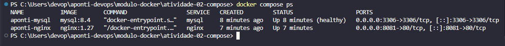
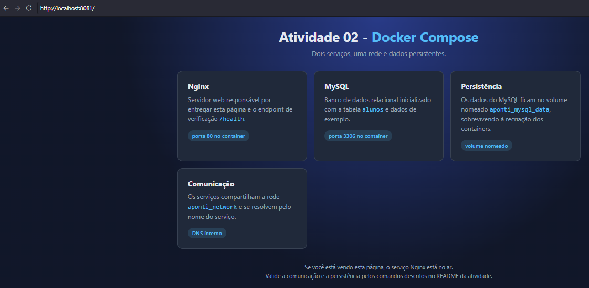
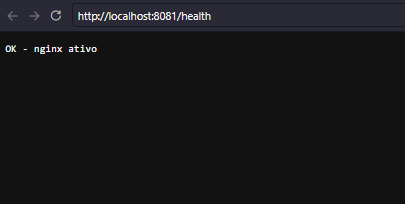
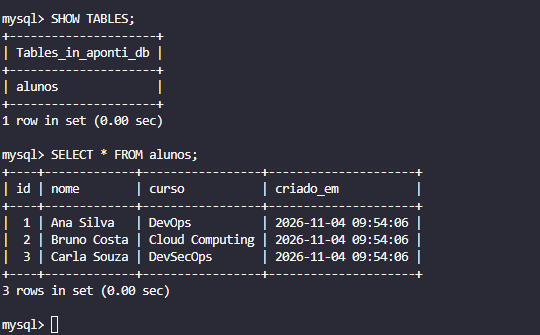
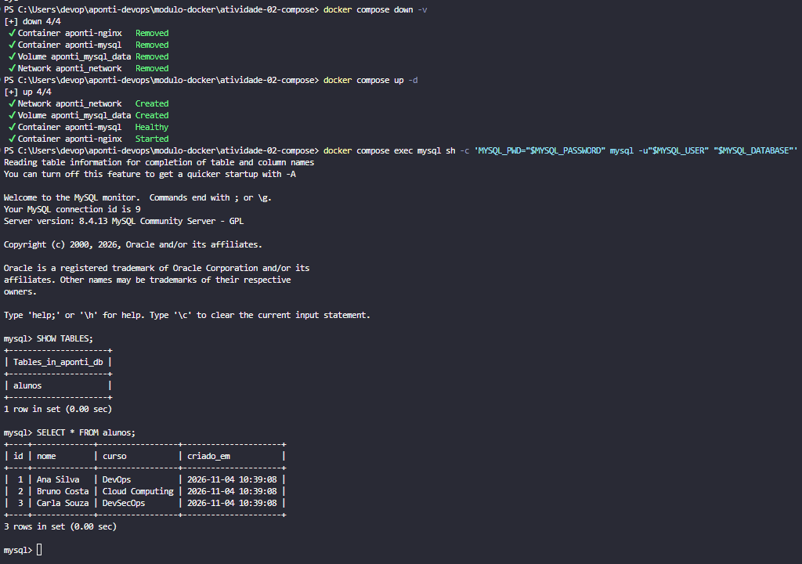

# Atividade Prática: Orquestração de Nginx e MySQL com Docker Compose

> Desenvolver e executar uma aplicação composta por dois serviços (**Nginx** e **MySQL**) utilizando Docker Compose, aplicando configuração por variáveis de ambiente, persistência de dados com volumes, comunicação entre serviços e verificação da sobrevivência dos dados após a recriação dos containers.

---

## 🎯 Objetivos de Aprendizagem

- Instalar e validar o **WSL2** e o **Docker Desktop** no Windows.
- Declarar uma aplicação multi-serviço em um arquivo `docker-compose.yml`.
- Externalizar credenciais e portas por meio de **variáveis de ambiente** (`.env`).
- Garantir persistência do MySQL com um **volume nomeado**.
- Comprovar a **comunicação** entre os containers pela rede interna do Compose.
- Verificar que os dados **permanecem** após `docker compose down` e `docker compose up`.

---

## 🏗️ Arquitetura da Aplicação

```text
Host (navegador / cliente MySQL)
   │
   │  localhost:8081                localhost:3306
   ▼                                  ▼
┌───────────────┐   aponti_network  ┌────────────────┐
│     nginx     │◄────────────────►│     mysql      │
│  porta 80     │   mysql:3306     │   porta 3306   │
└───────┬───────┘                  └───────┬────────┘
        │                                  │
        │ nginx/html + /health             │ volume nomeado
        ▼                                  ▼
   página estática               aponti_mysql_data
```

- **Nginx**: entrega a página da atividade e o endpoint `GET /health`.
- **MySQL**: banco inicializado com a tabela `alunos` e três registros de exemplo.
- **Rede**: os dois serviços participam da rede `aponti_network` e se resolvem pelo nome (`mysql`, `nginx`).
- **Volume**: `aponti_mysql_data` armazena `/var/lib/mysql`, preservando os dados fora do ciclo de vida do container.

---

## 📁 Estrutura de Arquivos

```text
atividade-02-compose/
├── docker-compose.yml
├── .env.example          # modelo versionável das variáveis
├── .env                  # valores locais (ignorado pelo Git)
├── nginx/
│   ├── default.conf      # configuração do servidor e do /health
│   └── html/
│       └── index.html    # página servida pelo Nginx
└── mysql/
    └── init/
        └── 01-init.sql   # script executado na primeira inicialização
```

> 🔐 O arquivo `.env` está no `.gitignore`. Versione apenas o `.env.example` e nunca grave credenciais reais no repositório.

---

## 🧰 Pré-requisitos: WSL2 e Docker Desktop (instalação guiada)

### 1. Instalar o WSL2

Abra o **PowerShell como Administrador** e execute:

```powershell
wsl --install
```

Reinicie a máquina quando solicitado. Depois confirme a versão e atualize:

```powershell
wsl --set-default-version 2
wsl --update
wsl --status
```

> Requisitos: Windows 10 versão 2004+ ou Windows 11, virtualização habilitada na BIOS/UEFI e atualizações do Windows aplicadas.

### 2. Instalar o Docker Desktop

1. Baixe o instalador oficial em **[https://www.docker.com/products/docker-desktop/](https://www.docker.com/products/docker-desktop/)**.
2. Durante a instalação, mantenha habilitada a opção **Use WSL 2 based engine**.
3. Abra o Docker Desktop e, em **Settings → Resources → WSL Integration**, habilite a integração com a distribuição Linux instalada.
4. Aguarde o ícone do Docker Desktop indicar que o engine está em execução.

### 3. Validar a instalação

```powershell
docker version
docker compose version
docker run --rm hello-world
```

Se o `hello-world` for exibido, o ambiente está pronto.

---

## 🚀 Passo a Passo da Prática

Todos os comandos abaixo devem ser executados na pasta da atividade:

```powershell
cd modulo-docker/atividade-02-compose
```

### Passo 1: Configurar as variáveis de ambiente

Copie o arquivo de exemplo:

```powershell
Copy-Item .env.example .env
```

Se estiver usando Git Bash ou WSL:

```bash
cp .env.example .env
```

Conteúdo esperado do `.env`:

```dotenv
MYSQL_ROOT_PASSWORD=root_lab_2026
MYSQL_DATABASE=aponti_db
MYSQL_USER=aponti_user
MYSQL_PASSWORD=aponti_lab_2026
MYSQL_PORT=3306
NGINX_PORT=8081
TZ=America/Sao_Paulo
```

> Em laboratório os valores acima são suficientes. Em qualquer ambiente real, troque as senhas e não versione o `.env`.

### Passo 2: Subir os serviços

```powershell
docker compose up -d
```

O Compose irá:

1. Baixar as imagens `mysql:8.4` e `nginx:1.27`.
2. Criar a rede `aponti_network` e o volume `aponti_mysql_data`.
3. Iniciar o MySQL e aguardar o **healthcheck** ficar saudável.
4. Iniciar o Nginx somente depois que o MySQL estiver pronto (`depends_on`).

Acompanhe a inicialização:

```powershell
docker compose ps
docker compose logs -f mysql
```

No `docker compose ps`, o MySQL deve aparecer como `healthy` e o Nginx como `running`. Use `Ctrl+C` para sair dos logs sem parar os containers.

### Passo 3: Acessar a aplicação Nginx

Abra no navegador:

```text
http://localhost:8081
```

Teste também o endpoint de saúde:

```powershell
curl.exe http://localhost:8081/health
```

Saída esperada:

```text
OK - nginx ativo
```

> No PowerShell, `curl` pode ser um alias de `Invoke-WebRequest`. Use `curl.exe` ou abra a URL diretamente no navegador.

### Passo 4: Acessar o banco de dados MySQL

Abra um cliente MySQL interativo **dentro do container** (sem precisar instalar o MySQL no host):

```powershell
docker compose exec mysql sh -c 'MYSQL_PWD="$MYSQL_PASSWORD" mysql -u"$MYSQL_USER" "$MYSQL_DATABASE"'
```

Dentro do prompt `mysql>`, execute:

```sql
SHOW TABLES;
DESCRIBE alunos;
SELECT * FROM alunos;
```

Saída esperada: a tabela `alunos` com os três registros criados pelo script `01-init.sql`.

Para sair do cliente:

```sql
exit;
```

> Acesso como `root` (quando necessário): `docker compose exec mysql sh -c 'MYSQL_PWD="$MYSQL_ROOT_PASSWORD" mysql -uroot'`.

### Passo 5: Inserir um registro para o teste de persistência

Ainda no cliente MySQL (ou abrindo novamente), execute:

```sql
INSERT INTO alunos (nome, curso) VALUES ('Aluno Persistencia', 'Docker Compose');
SELECT * FROM alunos;
```

Anote a quantidade de registros retornada (deve ser **4**).

### Passo 6: Testar a comunicação entre os serviços

O Nginx e o MySQL compartilham a mesma rede. Primeiro, valide a resolução do nome do serviço a partir do container do Nginx:

```powershell
docker compose exec nginx getent hosts mysql
```

A saída deve mostrar o IP interno do container MySQL associado ao nome `mysql`, por exemplo:

```text
172.18.0.2      mysql
```

Agora teste a conectividade TCP na porta do MySQL:

```powershell
docker compose exec nginx timeout 3 bash -c 'exec 3<>/dev/tcp/mysql/3306 && echo "OK: nginx alcancou mysql:3306"'
```

Saída esperada:

```text
OK: nginx alcancou mysql:3306
```

> Esse teste comprova que o Nginx resolve e alcança o MySQL pelo nome do serviço na rede `aponti_network`. O nome DNS só funciona porque ambos estão na mesma rede do Compose.

### Passo 7: Comprovar a persistência dos dados

Recrie os containers **sem remover o volume**:

```powershell
docker compose down
docker compose up -d
```

Aguarde o MySQL voltar a ficar saudável:

```powershell
docker compose ps
```

Consulte novamente os dados:

```powershell
docker compose exec mysql sh -c 'MYSQL_PWD="$MYSQL_PASSWORD" mysql -u"$MYSQL_USER" "$MYSQL_DATABASE" -e "SELECT * FROM alunos;"'
```

O registro **`Aluno Persistencia`** deve continuar presente. Isso demonstra que o volume `aponti_mysql_data` preservou os dados mesmo após os containers serem destruídos e recriados.

### Passo 8: Demonstrar a perda de dados ao remover o volume (opcional)

> ⚠️ Este passo **apaga definitivamente** os dados do laboratório.

```powershell
docker compose down -v
docker compose up -d
```

O parâmetro `-v` remove o volume nomeado. Na próxima inicialização, o MySQL cria um diretório vazio e executa novamente o `01-init.sql`, voltando aos **3 registros originais**:

```powershell
docker compose exec mysql sh -c 'MYSQL_PWD="$MYSQL_PASSWORD" mysql -u"$MYSQL_USER" "$MYSQL_DATABASE" -e "SELECT * FROM alunos;"'
```

Isso evidencia a diferença entre `down` (preserva volume) e `down -v` (descarta volume).

### Passo 9: Encerrar e limpar o ambiente

Para parar os serviços mantendo os dados:

```powershell
docker compose down
```

Para parar e remover também o volume e a rede:

```powershell
docker compose down -v
```

---

## 🧪 Comandos Úteis

| Objetivo | Comando |
| :--- | :--- |
| Subir em segundo plano | `docker compose up -d` |
| Ver status e healthcheck | `docker compose ps` |
| Acompanhar logs de um serviço | `docker compose logs -f mysql` |
| Abrir shell no Nginx | `docker compose exec nginx bash` |
| Abrir cliente MySQL | `docker compose exec mysql sh -c 'MYSQL_PWD="$MYSQL_PASSWORD" mysql -u"$MYSQL_USER" "$MYSQL_DATABASE"'` |
| Listar volumes | `docker volume ls` |
| Inspecionar o volume | `docker volume inspect aponti_mysql_data` |
| Inspecionar a rede | `docker network inspect aponti_network` |
| Recriar do zero | `docker compose down -v && docker compose up -d` |

---

## 🛠️ Solução de Problemas

| Sintoma | Causa provável | Solução |
| :--- | :--- | :--- |
| `port is already allocated` | Porta `3306` ou `8081` em uso | Altere `MYSQL_PORT` ou `NGINX_PORT` no `.env` e rode `docker compose up -d` novamente |
| MySQL reiniciando em loop | Variáveis de ambiente ausentes/inválidas | Confira o `.env` e execute `docker compose logs mysql` |
| Nginx não inicia | MySQL ainda não ficou `healthy` | Aguarde e verifique `docker compose ps` e os logs do MySQL |
| `getent: not found` ou `bash: not found` | Imagem diferente da esperada | Garanta que o serviço usa `nginx:1.27` (imagem Debian, com `bash` e `getent`) |
| Script `01-init.sql` não executou | Volume já existia de uma execução anterior | Só é executado com volume vazio; use `docker compose down -v` para reinicializar |
| Docker não conecta | Docker Desktop parado ou WSL2 sem integração | Abra o Docker Desktop e confira **Settings → Resources → WSL Integration** |
| `wsl --install` falha | Virtualização desabilitada na BIOS/UEFI | Habilite VT-x/AMD-V na BIOS e reinicie |

---

## 📋 Evidências

<details>
<summary>Clique para visualizar as capturas de tela</summary>

### Serviços ativos


### Página do Nginx


### Endpoint de saúde do Nginx


### Tabela no MySQL


### Persistência após recriar os containers


</details>

> Observação: a porta padrão desta atividade é `8081`, evitando conflito com serviços que já utilizam a `8080`.

---

## 💡 Conclusão

A atividade demonstra, na prática, os pilares da orquestração com Docker Compose: um único arquivo declarativo descreve os serviços, as variáveis de ambiente separam configuração de código, a rede interna viabiliza a comunicação por nome e o volume nomeado garante a persistência dos dados independentemente do ciclo de vida dos containers. Essa base é diretamente aplicável a ambientes de desenvolvimento, homologação e pipelines de CI/CD.
