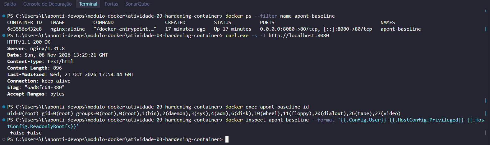
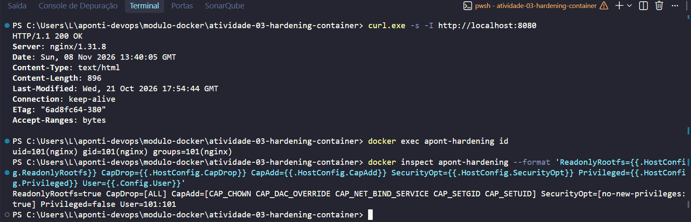
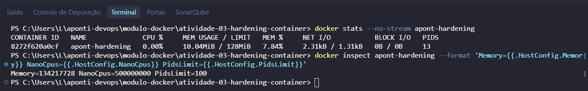
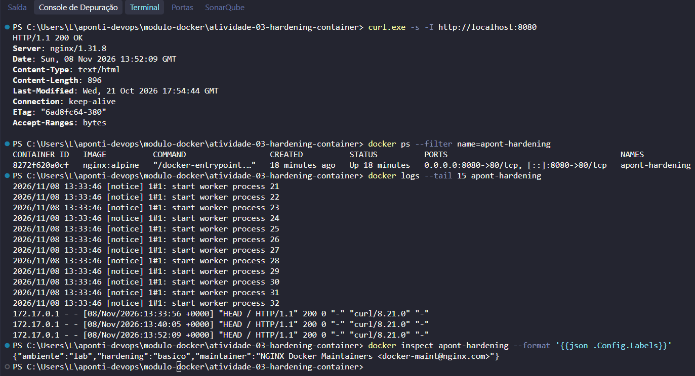
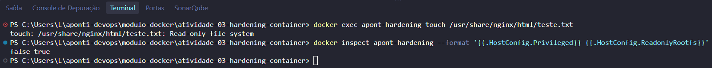

# Atividade Prática: Hardening Básico de um Contêiner (Relatório de Execução)

> Execução de um contêiner Docker com aplicação de controles básicos de segurança, observando **isolamento**, **controle de recursos**, **visibilidade** e **auditoria** no ambiente de execução.

---

## 🎯 Objetivo

Executar um contêiner e aplicar, na prática, controles de hardening, comparando o comportamento de um contêiner padrão (*baseline*) com um contêiner endurecido (*hardened*), e comprovar os resultados com inspeção, métricas, logs e testes de escrita.

---

## 🧰 Ambiente Utilizado

- **Sistema:** Windows com WSL2
- **Runtime:** Docker Desktop (Engine 29.8.0)
- **Imagem:** `nginx:alpine` (Nginx 1.31.8, oficial do Docker Hub)
- **Porta:** host `8080` → contêiner `80`
- **Contêineres analisados:** `apont-baseline` e `apont-hardening`

---

## 🏗️ Visão Geral da Execução

```text
Host (Windows + Docker Desktop)
   │
   ├── apont-baseline (sem hardening)
   │      └── nginx:alpine como root, rootfs gravável, sem limites
   │
   └── apont-hardening (com hardening)
          ├── rootfs somente leitura (--read-only + --tmpfs)
          ├── capabilities reduzidas (--cap-drop=ALL)
          ├── sem novos privilégios (--security-opt=no-new-privileges)
          ├── usuário não-root (101:101 / nginx)
          ├── limites: 128 MB de RAM, 0.5 CPU, 100 PIDs
          └── porta 8080 -> 80
```

---

## 📁 Estrutura Entregue

```text
atividade-03-hardening-container/
├── README.md
└── evidencias/
    ├── 01-baseline.png
    ├── 02-isolamento.png
    ├── 03-recursos.png
    ├── 04-visibilidade.png
    └── 05-auditoria.png
```

---

## 🔬 Execução Realizada

### 1. Container baseline (sem hardening)

Comandos executados:

```powershell
docker pull nginx:alpine
docker run -d --name apont-baseline -p 8080:80 nginx:alpine
docker ps --filter name=apont-baseline
curl.exe -s -I http://localhost:8080
docker exec apont-baseline id
docker inspect apont-baseline --format '{{.Config.User}} {{.HostConfig.Privileged}} {{.HostConfig.ReadonlyRootfs}}'
```

**Resultado obtido:**

- Contêiner em `Up`, porta `8080->80`
- Resposta `HTTP/1.1 200 OK` (`Server: nginx/1.31.8`)
- Processo como **`uid=0(root)`**
- `inspect`: usuário vazio (root), `Privileged=false`, `ReadonlyRootfs=false`

Na prática, o serviço funcionava, mas sem nenhuma barreira adicional. O rootfs era gravável e não havia limites de recursos.

### 2. Container hardened: isolamento

Comando executado:

```powershell
docker run -d --name apont-hardening --read-only --tmpfs /tmp --tmpfs /var/cache/nginx:uid=101,gid=101,mode=0755 --tmpfs /var/run:uid=101,gid=101,mode=0755 --cap-drop=ALL --cap-add=NET_BIND_SERVICE --cap-add=CHOWN --cap-add=DAC_OVERRIDE --cap-add=SETGID --cap-add=SETUID --security-opt=no-new-privileges:true --user 101:101 --memory=128m --cpus=0.5 --pids-limit=100 --label ambiente=lab --label hardening=basico -p 8080:80 nginx:alpine
```

**Resultado obtido:**

- Serviço respondendo normalmente (`HTTP/1.1 200 OK`)
- Processo como **`uid=101(nginx)`**, não mais root
- `inspect` confirmou:
  - `ReadonlyRootfs=true`
  - `CapDrop=[ALL]`
  - `CapAdd=[CAP_CHOWN CAP_DAC_OVERRIDE CAP_NET_BIND_SERVICE CAP_SETGID CAP_SETUID]` (apenas o mínimo necessário para o Nginx iniciar)
  - `SecurityOpt=[no-new-privileges:true]`
  - `Privileged=false`
  - `User=101:101`

Sem as capabilities `CHOWN`/`SETUID`/`SETGID`/`DAC_OVERRIDE`, o Nginx falha ao iniciar com `chown("/var/cache/nginx/client_temp", 101) failed (1: Operation not permitted)`. Por isso elas foram devolvidas de forma pontual, mantendo o restante removido.

### 3. Controle de recursos

Comandos executados:

```powershell
docker stats --no-stream apont-hardening
docker inspect apont-hardening --format 'Memory={{.HostConfig.Memory}} NanoCpus={{.HostConfig.NanoCpus}} PidsLimit={{.HostConfig.PidsLimit}}'
```

**Resultado obtido:**

- `docker stats`: **10.04MiB / 128MiB** de memória, CPU `0.00%`, **13 PIDs**
- `inspect`: `Memory=134217728` (128 MB), `NanoCpus=500000000` (0.5 CPU), `PidsLimit=100`

O consumo ficou folgado dentro do teto, e os limites ficaram ativos para proteger o host contra uso excessivo (OOM e fork bomb, por exemplo).

### 4. Visibilidade

Comandos executados:

```powershell
docker ps --filter name=apont-hardening
docker logs --tail 15 apont-hardening
docker inspect apont-hardening --format '{{json .Config.Labels}}'
```

**Resultado obtido:**

- `ps` filtrado exibiu apenas o contêiner da atividade (`Up 18 minutes`, `8080->80`)
- Logs do Nginx com os acessos registrados, por exemplo:
  `172.17.0.1 - - [08/Nov/2026:13:52:09 +0000] "HEAD / HTTP/1.1" 200`
- Labels: `{"ambiente":"lab","hardening":"basico","maintainer":"NGINX Docker Maintainers <docker-maint@nginx.com>"}`

Nome, labels e logs permitiram identificar e auditar o contêiner sem precisar vasculhar todo o host.

### 5. Auditoria: teste de escrita

Comandos executados:

```powershell
docker exec apont-hardening touch /usr/share/nginx/html/teste.txt
docker inspect apont-hardening --format '{{.HostConfig.Privileged}} {{.HostConfig.ReadonlyRootfs}}'
```

**Resultado obtido:**

```text
touch: /usr/share/nginx/html/teste.txt: Read-only file system
false true
```

A tentativa de escrita foi negada pelo rootfs somente leitura, confirmando que mesmo com acesso ao contêiner não é possível alterar os arquivos do serviço.

---

## 📊 Comparação: Baseline x Hardened

| Aspecto | Baseline (`apont-baseline`) | Hardened (`apont-hardening`) |
| :--- | :--- | :--- |
| Usuário | `root` (uid 0) | `nginx` (uid 101) |
| Rootfs | Gravável (`ReadonlyRootfs=false`) | Somente leitura (`true`) |
| Capabilities | Padrão da imagem | `ALL` removidas, só 5 mínimas |
| Novos privilégios | Permitidos | Bloqueados (`no-new-privileges`) |
| Privileged | `false` | `false` |
| Memória / CPU / PIDs | Sem limite | 128 MB / 0.5 CPU / 100 PIDs |
| Escrita em `/usr/share/nginx/html` | Permitida | Negada (`Read-only file system`) |
| Serviço responde | `HTTP 200` | `HTTP 200` |

O ponto central: o serviço continuou funcionando, mas com superfície de ataque e consumo drasticamente menores.

---

## ⚠️ Ocorrências Durante a Execução

- **Contêineres de outros projetos aparecendo no `docker ps`:** resolvido com `--filter name=apont-baseline` / `--filter name=apont-hardening`, exibindo apenas o contêiner da atividade nas evidências.
- **Conflito de nome (`/apont-baseline is already in use`):** contêiner de uma execução anterior ainda existia; removido com `docker rm -f apont-baseline` antes de reexecutar.
- **Valores de `CapDrop`/`SecurityOpt` ocultos no `Select-String`:** o filtro só capturava a linha da chave. Substituído por `docker inspect --format`, que exibe os valores completos numa única linha.
- **Avisos nos logs** sobre `default.conf` (read-only) e `user directive` (usuário não-root): comportamento esperado nesta configuração, sem impacto no `HTTP 200`.

---

## 📸 Evidências


<details>
<summary>Clique para visualizar as capturas de tela</summary>

### Container baseline


### Isolamento


### Controle de recursos


### Visibilidade


### Auditoria


</details>

---

## 💡 Conclusão

A execução demonstrou, na prática, os quatro pilares propostos. O **isolamento** foi obtido com rootfs somente leitura, capabilities mínimas, `no-new-privileges` e usuário não-root. O **controle de recursos** limitou memória, CPU e processos, com consumo observado bem abaixo dos tetos. A **visibilidade** veio de nome, labels, `ps`, `logs` e `inspect`. A **auditoria** foi comprovada pela inspeção do `HostConfig` e pela negação real de escrita no sistema de arquivos.

O contêiner endurecido manteve o mesmo serviço (`HTTP 200`) com superfície de ataque e consumo drasticamente menores. É a base prática para rodar cargas com segurança em qualquer ambiente.
