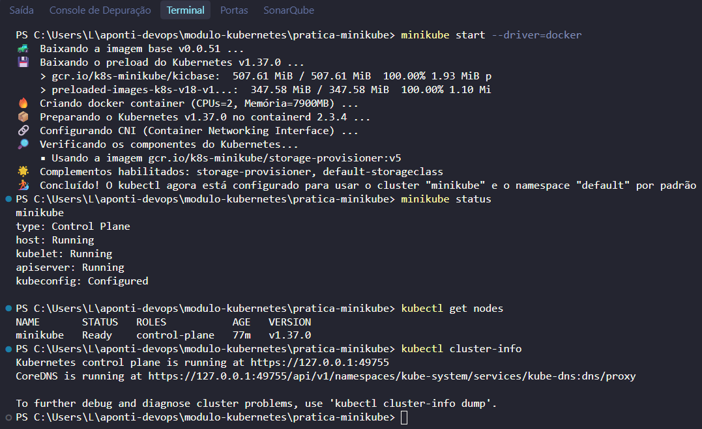
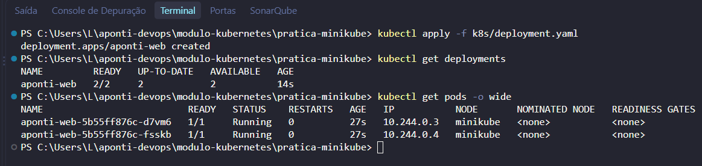
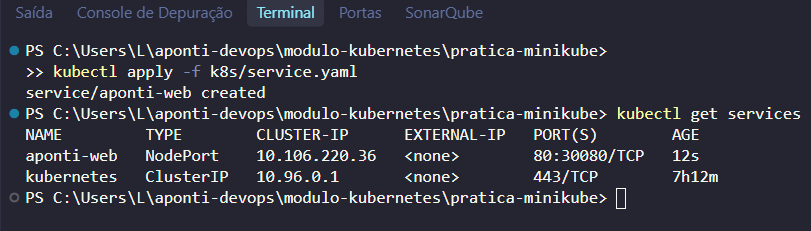
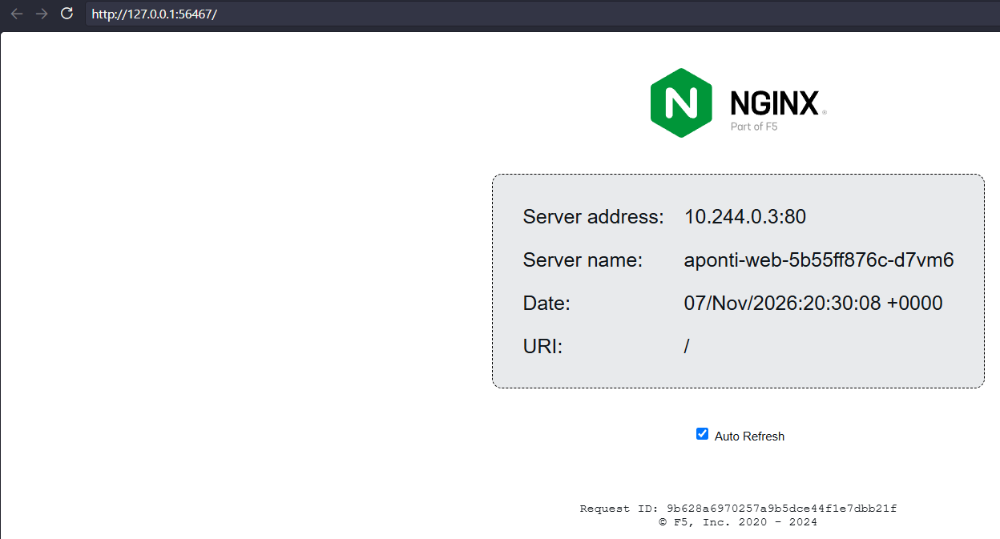
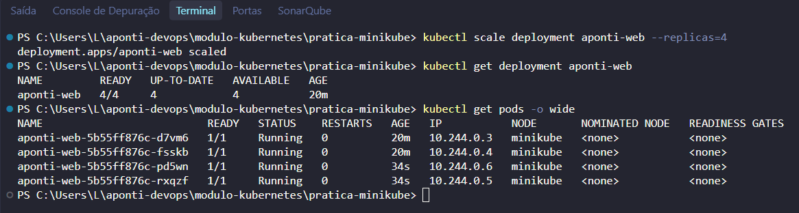
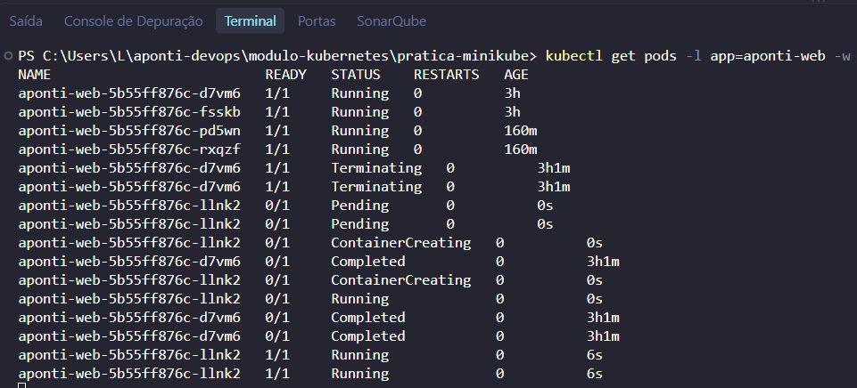

# Cluster Kubernetes Local com Minikube

> Criar um cluster Kubernetes local com Minikube usando o Docker como driver, implantar uma aplicação com Deployment, visualizar Pods, expor o serviço, escalar réplicas e comprovar a autocura do cluster.

---

## 🎯 Objetivos de Aprendizagem

- Entender o papel do **Docker**, do **Minikube** e do **kubectl** no ambiente local.
- Criar um cluster Kubernetes local com o driver Docker.
- Declarar e aplicar um **Deployment**.
- Visualizar e inspecionar **Pods**.
- Expor a aplicação por meio de um **Service**.
- Escalar a aplicação com múltiplas réplicas.
- Testar a **autocura**, observando o Kubernetes recriar um Pod removido.
- Compreender o conceito de **estado desejado**.

---

## 🏗️ Arquitetura da Prática

```text
Windows
  │
  ├── Docker
  │
  ├── Minikube
  │       └── cria o cluster
  │
  └── kubectl
          └── administra o cluster
                  │
                  ▼
             Kubernetes
                  │
          ┌───────┴───────┐
          ▼               ▼
     Control Plane      Node
                          │
                         Pod
                          │
                      Container
```

- **Docker**: fornece a camada de containers usada pelo Minikube.
- **Minikube**: cria e gerencia o cluster Kubernetes local.
- **kubectl**: envia os manifests e administra os recursos do cluster.
- **Control Plane**: mantém o estado desejado do cluster.
- **Node**: executa os Pods e seus containers.

---

## 📁 Estrutura de Arquivos

```text
pratica-minikube/
├── README.md
├── k8s/
│   ├── deployment.yaml
│   └── service.yaml
└── evidencias/
```

- `deployment.yaml`: define o Deployment `aponti-web` com 2 réplicas.
- `service.yaml`: expõe o Deployment por um Service do tipo `NodePort`.

A imagem utilizada é **`nginxdemos/hello:0.4`**. Ela exibe o nome do Pod e o endereço do servidor na página, o que facilita visualizar a distribuição entre réplicas e a recriação de Pods.

---

## 🧰 Pré-requisitos

- Windows com **WSL2** atualizado.
- **Docker Desktop** em execução.
- **Minikube** e **kubectl** instalados.

Instalação via `winget`:

```powershell
winget install Kubernetes.minikube
winget install Kubernetes.kubectl
```

Confirme as versões:

```powershell
docker version
minikube version
kubectl version --client
```

> Antes de começar, abra o Docker Desktop e aguarde o engine ficar em execução.

---

## 🚀 Passo a Passo da Prática

Todos os comandos devem ser executados na pasta da prática:

```powershell
cd modulo-kubernetes/pratica-minikube
```

### Passo 1: Iniciar o cluster

```powershell
minikube start --driver=docker
```

Confirme o cluster e o nó:

```powershell
minikube status
kubectl get nodes
kubectl cluster-info
```

O nó `minikube` deve aparecer com o status `Ready`.

> Se já existir um cluster parado, o comando `minikube start --driver=docker` reaproveita o perfil existente.

### Passo 2: Criar o Deployment

```powershell
kubectl apply -f k8s/deployment.yaml
kubectl get deployments
kubectl get pods
kubectl get pods -o wide
```

O Deployment `aponti-web` deve ficar com `READY 2/2`, e dois Pods devem estar em `Running`.

Para inspecionar os detalhes:

```powershell
kubectl describe deployment aponti-web
kubectl describe pod -l app=aponti-web
```

### Passo 3: Expor a aplicação com Service

```powershell
kubectl apply -f k8s/service.yaml
kubectl get services
```

Abra a aplicação:

```powershell
minikube service aponti-web
```

O comando cria o túnel local e abre a aplicação no navegador. Mantenha o terminal aberto enquanto estiver usando o serviço.

Alternativa com `port-forward`:

```powershell
kubectl port-forward service/aponti-web 8082:80
```

Depois acesse `http://localhost:8082`.

> O `port-forward` serve para acesso local e temporário. O Service continua sendo o recurso responsável por expor a aplicação dentro do cluster.

### Passo 4: Escalar a aplicação

```powershell
kubectl scale deployment aponti-web --replicas=4
kubectl get deployment aponti-web
kubectl get pods -o wide
```

O Deployment deve mostrar `READY 4/4` e quatro Pods devem estar em execução.

Atualize a página da aplicação algumas vezes. Como a imagem `nginxdemos/hello` mostra o nome do Pod, é possível observar respostas de Pods diferentes.

### Passo 5: Testar a autocura

Abra um terminal para acompanhar os Pods:

```powershell
kubectl get pods -l app=aponti-web -w
```

Em um segundo terminal, remova um Pod:

```powershell
$pod = kubectl get pods -l app=aponti-web -o jsonpath="{.items[0].metadata.name}"
kubectl delete pod $pod
```

No terminal do `-w`, observe o Pod sendo encerrado e um novo Pod sendo criado automaticamente. Use `Ctrl+C` para encerrar o acompanhamento.

O Deployment mantém o estado desejado: se um Pod falha ou é removido, o Kubernetes cria outro para substituí-lo.

### Passo 6: Conferir o estado desejado

```powershell
kubectl get deployment aponti-web
kubectl get replicaset
kubectl get pods -l app=aponti-web
```

O número de Pods disponíveis deve continuar igual ao número de réplicas definido no Deployment.

### Passo 7: Encerrar e limpar o ambiente

Remova os recursos criados:

```powershell
kubectl delete -f k8s/
```

Pare o cluster:

```powershell
minikube stop
```

Se quiser remover o cluster completamente:

```powershell
minikube delete
```

---

## 🧪 Comandos Úteis

| Objetivo | Comando |
| :--- | :--- |
| Iniciar o cluster | `minikube start --driver=docker` |
| Ver status do cluster | `minikube status` |
| Ver nós | `kubectl get nodes` |
| Aplicar manifests | `kubectl apply -f k8s/` |
| Ver Deployments | `kubectl get deployments` |
| Ver Pods | `kubectl get pods -o wide` |
| Ver Services | `kubectl get services` |
| Escalar réplicas | `kubectl scale deployment aponti-web --replicas=4` |
| Acompanhar Pods | `kubectl get pods -l app=aponti-web -w` |
| Remover recursos | `kubectl delete -f k8s/` |
| Parar o cluster | `minikube stop` |
| Excluir o cluster | `minikube delete` |

---

## 🛠️ Solução de Problemas

| Sintoma | Causa provável | Solução |
| :--- | :--- | :--- |
| `Cannot connect to the Docker daemon` | Docker Desktop parado | Abra o Docker Desktop e aguarde o engine iniciar |
| `minikube start` falha | Cluster anterior inconsistente | Execute `minikube delete` e tente novamente |
| Pods em `ImagePullBackOff` | Falha ao baixar a imagem | Verifique a internet e execute `kubectl describe pod -l app=aponti-web` |
| Serviço não abre no navegador | Túnel do Minikube encerrado | Rode novamente `minikube service aponti-web` ou use `kubectl port-forward` |
| Porta `30080` em uso | Conflito com outro serviço | Altere `nodePort` no `service.yaml` para outra porta entre `30000` e `32767` |
| `kubectl` não encontrado | CLI não instalada | Execute `winget install Kubernetes.kubectl` e reabra o terminal |

---

## 📸 Evidências

<details>
<summary>Clique para visualizar as capturas de tela</summary>

### Cluster e nó prontos


### Deployment e Pods


### Service criado


### Aplicação no navegador


### Escala para 4 réplicas


### Autocura


</details>


---

## 💡 Conclusão

A prática demonstra o ciclo básico de operação de uma aplicação no Kubernetes: o Deployment declara o estado desejado, o control plane compara esse estado com o estado atual e o reconcilia continuamente. O Service fornece acesso estável aos Pods, o escalonamento ajusta a capacidade e a autocura garante que a quantidade de réplicas seja mantida mesmo quando um Pod é removido. Esse comportamento é a base da resiliência e da automação em ambientes de produção.
