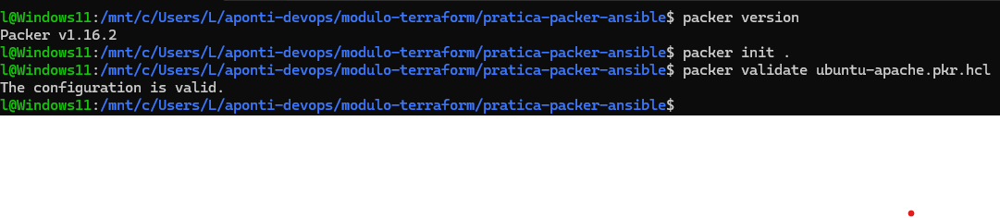
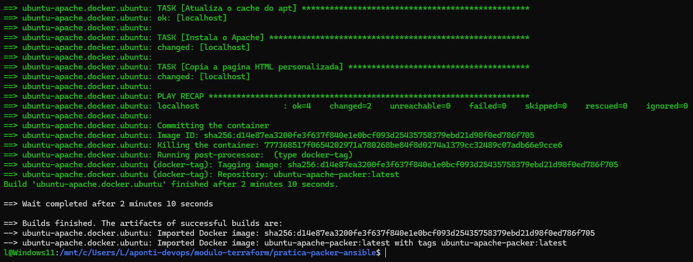
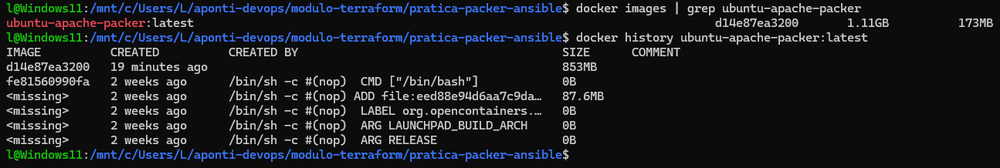
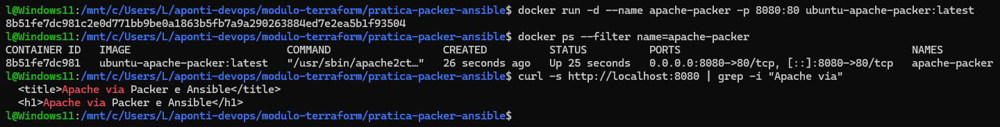

# Prática: Infraestrutura Imutável com Packer e Ansible (Relatório de Execução)

> Construção de uma imagem Docker personalizada a partir do Ubuntu, com o Packer automatizando a construção e o Ansible configurando o servidor web Apache e a página HTML personalizada. Ao final, um contêiner foi executado a partir da imagem e o servidor foi verificado.

---

## 🎯 Objetivo

Aplicar os conceitos de infraestrutura como código e infraestrutura imutável na construção de uma imagem Docker. A configuração do Apache ficou gravada na imagem durante o build, sem nenhuma alteração manual no contêiner depois da criação.

---

## 🧰 Ambiente Utilizado

- **Sistema:** Windows com WSL 2 e Ubuntu
- **Runtime:** Docker Desktop com integração WSL habilitada
- **Packer:** v1.16.2, com plugin Docker v1.1.5
- **Ansible:** executado dentro do contêiner de build, com conexão local
- **Imagem base:** `ubuntu:24.04`
- **Imagem final:** `ubuntu-apache-packer:latest`
- **Porta:** host `8080` para contêiner `80`

---

## 🏗️ Visão Geral da Execução

```text
WSL 2 (Ubuntu)
  │
  ├── Packer: le o ubuntu-apache.pkr.hcl e orquestra o build
  ├── Ansible: instala o Apache e copia o index.html
  │
  └── Docker Desktop (engine via integração WSL)
        │
        ├── Container de build (ubuntu:24.04)
        │      └── provisionamento via Packer e Ansible
        │
        └── Imagem final: ubuntu-apache-packer:latest
               │
               └── Container apache-packer (porta 8080 para 80)
                      └── Página HTML personalizada
```

O Packer iniciou um contêiner a partir do Ubuntu, copiou o playbook e a página para dentro dele, executou o Ansible e gravou o resultado com `commit`. O post-processor `docker-tag` aplicou a tag `ubuntu-apache-packer:latest` na imagem final.

---

## 📁 Estrutura Entregue

```text
pratica-packer-ansible/
├── README.md
├── ubuntu-apache.pkr.hcl   # template Packer (builder Docker, provisionadores e tag)
├── playbook.yml            # playbook Ansible (instala o Apache e copia a página)
├── index.html              # página HTML personalizada servida pelo Apache
└── evidencias/
    ├── 01-template-validado.png
    ├── 02-build-packer.png
    ├── 03-imagem-criada.png
    └── 04-apache-funcionando.png
```

---

## 🔬 Execução Realizada

### 1. Template validado

Comandos executados:

```bash
packer version
packer init .
packer validate ubuntu-apache.pkr.hcl
```

Resultado obtido:

- Packer `v1.16.2` instalado no Ubuntu
- Plugin `github.com/hashicorp/docker v1.1.5` instalado pelo `packer init`
- Validação com a mensagem `The configuration is valid.`

### 2. Build com Packer e Ansible

Comando executado:

```bash
packer build ubuntu-apache.pkr.hcl
```

Resultado obtido:

- Tarefa `Atualiza o cache do apt` concluída com `ok` no localhost
- Tarefa `Instala o Apache` concluída com `changed`
- Tarefa `Copia a pagina HTML personalizada` concluída com `changed`
- `PLAY RECAP` com `ok=4 changed=2 unreachable=0 failed=0`
- Contêiner gravado com `commit`, com ID `sha256:d14e87ea3200fe3f637f840e1e0bcf093d25435758379ebd21d98f0ed786f705`
- Post-processor `docker-tag` com repositório `ubuntu-apache-packer:latest`
- Build finalizado após 2 minutos e 10 segundos, com dois artefatos importados: o ID da imagem e a tag `ubuntu-apache-packer:latest`

### 3. Imagem criada

Comandos executados:

```bash
docker images | grep ubuntu-apache-packer
docker history ubuntu-apache-packer:latest
```

Resultado obtido:

- Imagem `ubuntu-apache-packer:latest` listada com ID `d14e87ea3200`
- Histórico com as camadas da imagem, incluindo a camada de instalação dos pacotes e as camadas base do Ubuntu

A configuração ficou gravada nas camadas da imagem. Essa é a parte central da infraestrutura imutável: o contêiner futuro já nasce com o Apache instalado e a página copiada.

### 4. Contêiner executado e Apache verificado

Comandos executados:

```bash
docker run -d --name apache-packer -p 8080:80 ubuntu-apache-packer:latest
docker ps --filter name=apache-packer
curl -s http://localhost:8080 | grep -i "Apache via"
```

Resultado obtido:

- Contêiner `apache-packer` criado a partir da imagem, com ID `8b51fe7dc981`
- Status `Up` na captura, com portas `0.0.0.0:8080->80/tcp`
- Comando do processo `/usr/sbin/apache2ctl`, em primeiro plano
- Resposta do `curl` com `<title>Apache via Packer e Ansible</title>` e `<h1>Apache via Packer e Ansible</h1>`

A página retornada foi a página personalizada do `index.html`, confirmando que o Apache instalado pelo Ansible estava servindo o conteúdo gravado na imagem.

---

## ⚠️ Ocorrências Durante a Execução

- **Packer antigo do pacote do Ubuntu (v1.0.0):** essa versão não reconhecia o formato HCL e tentava ler o template como JSON, com erro na primeira letra. Foi substituída pelo binário oficial 1.16.2 instalado em `/usr/local/bin`, com `hash -r` para atualizar o cache de comando do bash.
- **Nome do arquivo de template divergente:** o repositório tinha `template.pkr.hcl`, mas os comandos usavam `ubuntu-apache.pkr.hcl`. O arquivo foi renomeado para o nome usado nos comandos.
- **Build falhando em menos de um segundo:** o Packer terminava com `exit status 1` e nenhum artefato, sem executar os provisionadores. A causa foi o Docker inacessível de dentro do WSL. Com a integração WSL do Docker Desktop habilitada para o Ubuntu e o Apply & Restart aplicado, o build passou a funcionar e terminou em 2 minutos e 10 segundos.
- **Outros contêineres aparecendo no `docker ps`:** resolvido com `--filter name=apache-packer`, exibindo apenas o contêiner da atividade nas evidências.

---

## 📸 Evidências

<details>
<summary>Clique para visualizar as capturas de tela</summary>

### Template validado


### Build do Packer


### Imagem criada


### Apache funcionando


</details>

---

## 💡 Conclusão

A execução mostrou a infraestrutura imutável em funcionamento. O Packer automatizou a construção da imagem a partir do Ubuntu, o Ansible declarou a instalação do Apache e a cópia da página personalizada, e a configuração ficou gravada nas camadas da imagem final. O contêiner executado a partir dessa imagem já nasceu pronto, sem nenhuma alteração manual posterior. Para alterar o servidor, basta ajustar o template ou o playbook e construir uma nova imagem, mantendo o ambiente previsível, reproduzível e versionável.
